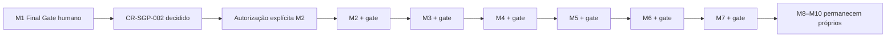

# CR-SGP-002 — proposta de organização essencial M2–M7

**Estado:** DRAFT / PENDING HUMAN DECISION / NOT EXECUTED.
**Autoridade:** Master v1.1 FROZEN, CR-SGP-001 e autorização humana para planeamento. Nenhuma disposição desta proposta altera o Master ou autoriza M2.

## Razão e decisões solicitadas

Comparar duas organizações funcionais de cinco módulos, preservando o ciclo patrimonial e os gates M2–M7. O agrupamento B foi confirmado pelo humano como proposta; a ordem de retomada exige comparar A e B, sem fixar definitivamente o âmbito.

Decisões separadas necessárias: (1) M1 Final Gate e disposição própria do risco 503; (2) escolha A/B; (3) aplicabilidade e aprovação individual dos diferimentos; (4) equipa, taxas e orçamento; (5) autorização explícita de M2. Uma decisão não concede automaticamente as restantes.

## Alternativas

| Capacidade / owner funcional | Alternativa A | Alternativa B |
|---|---|---|
| M2 organização, localizações, referenciais | A1 | B1 |
| M3 cadastro e entrada patrimonial | A2 | B2 |
| M4 afectação, movimentação, custódia | A3 | B3 |
| M5 inventário e reconciliação | A4 | B4 |
| M6 manutenção e ciclo de vida | Capacidade básica embutida; **A2 é owner único**, A3 fornece workflow de suporte | B5, owner dedicado |
| M7 relatórios e painel | A5 | Capacidade transversal obrigatória; **M7 é owner funcional único**, com vistas distribuídas pelos cinco módulos |

Os milestones e gates M2→M3→M4→M5→M6→M7 continuam a existir em ambas. A ausência de um menu M6 na alternativa A não elimina o gate M6 nem os seus requisitos. Na B, transversal não significa opcional ou sem owner para os relatórios.

| Comparação | A | B |
|---|---|---|
| Vantagem principal | Relatórios/painel têm superfície e responsabilidade visíveis como quinto módulo | Manutenção/ciclo de vida têm fronteira própria e menor acoplamento ao cadastro |
| Limitação principal | Estados de manutenção/abate e transacções atravessam A2/A3; exige contratos e coordenação explícita | Relatórios podem ficar dispersos se o owner M7 e a backlog transversal não forem mantidos |
| Melhor encaixe a validar | Operação centrada em cadastro/movimento e consulta, com manutenção básica | Operação com ordens de trabalho, garantias, peças, custos e abate relevantes |
| Segurança, auditabilidade e PostgreSQL | Mesma exigência integral do Master | Mesma exigência integral do Master |
| Economia presumida por mudar rótulos | Nenhuma: manutenção básica e relatórios reais custam em ambas | Nenhuma: explicitar M6 não dispensa M7 |

**Recomendação de planeamento:** B como referência arquitectural, por explicitar a fronteira M6, mantendo A como alternativa viável. A escolha é humana e não está aprovada por este texto. Sem conhecer o processo/volume institucional, a diferença de custo é pequena perante a incerteza; não se promete economia automática.

## Cobertura e tratamentos de requisitos

Matriz completa: `docs/requirements/CR-SGP-002-TRACEABILITY.json` e versão Markdown. São identificadores locais da proposta, com cláusula, linha e hash da origem; não substituem requisitos canónicos.

- **OBRIGATÓRIO:** entrega e ensaios exigidos pelo Master, incluindo hierarquia sem ciclos, cadastro real, entrada/recepção/incorporação separadas, custódia e cadeia histórica, empréstimos/reservas básicos, reconciliação, manutenção/garantia/stock/custos básicos, abate e relatórios/exports autorizados.
- **SIMPLIFICADO PROPOSTO:** implementação mínima real que conserva resultados e critérios: workflow parametrizado por catálogo controlado, notificações internas transaccionais, mobile web online com QR/barcode, dashboards/relatórios SQL e SLA básico por eventos. Não se dispensam persistência, API, RLS, auditoria, testes ou paginação.
- **DIFERIMENTO PROPOSTO CONDICIONAL:** offline/sincronização, fórmulas financeiras avançadas e intangíveis/licenças conforme aplicabilidade/homologação. A marcação não é dispensa: se necessários ou habilitados no processo aprovado, devem integrar a entrega antes do gate correspondente. Diferir obrigação canónica exige decisão CR competente; até lá prevalece o Master integral.

Capacidades avançadas M6 podem ser faseadas mediante decisão expressa, mas incidente→ordem de trabalho→garantia/prestador→peças/custo→retorno e proposta/aprovação de abate continuam no núcleo. SLA básico, stock de peças e histórico não desaparecem por se usar a expressão “manutenção básica”.

Índice transversal adicional do §9/§95-A: documentação em storage controlado, classificação/criticidade distintas, master data e duplicados, empréstimos/devoluções, termos versionados, alertas de condições reais e qualidade/reconciliação mantêm cobertura nas fases respectivas. Migração institucional final, integrações RH/ERP/SIEM, hardening/aceitação e produção continuam nos milestones M8–M10 quando aplicáveis; não são dispensados nem executados por este CR.

## Arquitectura proposta, sem implementação

Manter React/TypeScript/Vite, Node/TypeScript/Fastify, OpenAPI `/api/v1` e PostgreSQL. Reutilizar sessões, AuthorizationPort, RBAC/ABAC, security context, classificação/compartimentos, SoD e writer de auditoria M1. Não criar um segundo IAM, um motor RLS paralelo, um banco JSON ou uma API sem persistência.

Fluxo por operação: UI real → API validada → serviço/regra → autorização M1 → repositório SQL parametrizado/RLS → transacção PostgreSQL → auditoria atómica. Falha de autoridade/auditoria falha fechada. O browser nunca decide a autorização.

Fronteiras propostas: organização/referenciais; entrada/cadastro; responsabilidade/workflow; contagem/reconciliação; ciclo de vida; consultas/relatórios M7. Cada entidade tem owner de escrita único. Relatórios são projecções autorizadas, sem segunda fonte de verdade. Referências entre domínios usam UUIDs e contratos versionados; não duplicam estados de custódia/localização.

M2 deverá ligar unidades institucionais reais a scopes IAM existentes por ADR/migration, preservando IDs e grants; scope vazio não se torna wildcard. M1 só provou referências técnicas IAM_SCOPE, sem departamentos reais. A consistência entre essa ligação, a API e o RLS precisa de prova própria no gate M2.

Estados e transições, atributos de segurança, idempotência, concorrência, parâmetros de workflow e access matrix exigem DoR/ADR antes de cada milestone. Ficam proibidos claims de role enviados pelo cliente, patch SQL genérico, owners com bypass e migrações retroactivas. Novas migrations serão apenas forward-only após autorização; nenhum ficheiro007 ou schema patrimonial é criado neste planeamento.

## Dependências e calendário de autorização

M7 recolhe requisitos/proveniência ao longo do planeamento, mas a sua implementação e gate exigem autorização própria. Não se antecipa código de milestones bloqueados. O prazo começa em D0, definido apenas depois das decisões e recursos válidos; não há data de produção prometida.

## Critérios de aceitação propostos

Cada milestone conserva o seu gate exacto do Master. DoR identifica actores, regras, dados reais, API/DB, scope/classificação/compartimentos, SoD, auditoria e negativos. DoD exige UI/API/PostgreSQL reais, migrations, regras/constraints, autorização/RLS, erros sanitizados, testes, documentação, scans e evidências. Não reduzir a suite de regressão M0/M1.

`E2E-SGP-ESS-001` é proposta transversal em documento próprio. Só poderá ser executada quando os domínios correspondentes forem implementados e autorizados. Não substitui testes focais, SQL/RLS, negativos, concorrência, rollback, gates M2–M7 ou aceitação M9.

## Impactos, compatibilidade e recuperação

- **Arquitectura:** agrupar superfícies/owners; preservar a arquitectura canónica. Qualquer divergência futura requer ADR/CR antes de implementação.
- **Segurança:** zero redução de RBAC/ABAC/RLS, need-to-know, SoD, logs sanitizados ou auditoria. Exports limitados e auditáveis; documentos não públicos.
- **DB:** futuras tabelas/constraints/índices e referências para dados reais somente após DoR. PostgreSQL é a fonte de verdade; sem seeds patrimoniais fictícios.
- **Compatibilidade:** regressão cumulativa e preservação integral M0/M1. Não editar Masters/FROZEN nem migrations publicadas 001–006.
- **Testes:** novas provas por milestone, fixtures TEST identificáveis e descartáveis, zero bypass operacional. Medir desempenho no alvo institucional antes de produção.
- **Rollback/recuperação:** antes de cada futura mudança, backup validado e plano de compatibilidade/recuperação. Preferir correcção forward-only e rollback de aplicação compatível; não apagar histórico, schema aprovado ou dados silenciosamente. Dúvida mantém o gate bloqueado.

## Custos, esforço e calendário

Ver `CR-SGP-002-ESTIMATES.md`. As duas alternativas têm orçamento paramétrico comparável para a mesma cobertura essencial. Taxas, moeda e capacidade não foram aprovadas; não se inventam preços contratuais, tarifas de IA ou custos de infraestrutura.

## Quadro para decisão formal

| Decisão | Estado actual |
|---|---|
| Escolher A, B ou solicitar revisão | PENDENTE |
| Aplicabilidade e diferimentos por requisito | PENDENTE; Master integral prevalece |
| Responsáveis funcionais e capacidade/taxas | A DESIGNAR/APROVAR |
| Arquitectura/DoR de cada milestone | Proposta, não implementada |
| Executar E2E-SGP-ESS-001 | NÃO AUTORIZADO NESTE CHECKPOINT |
| Aprovar/executar CR-SGP-002 | NÃO APROVADO / NÃO EXECUTADO |
| Iniciar M2, merge, produção | NÃO AUTORIZADO |

**Approver previsto:** autoridade humana competente; nenhuma assinatura ou aprovação é preenchida pelo agente. O documento satisfaz a estrutura de CR do Master §69 e prepara a decisão, sem alterar o Master FROZEN.
